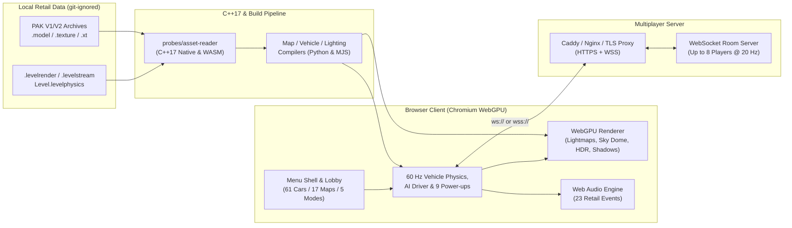

# Blur Web

A browser-native port and clean-room WebGPU/WebAssembly runtime for **Blur**, built from the ground up using the `BlurRebuilt` engineering reference.

Game logic, binary asset parsers, and deterministic simulation run in the browser (C++17 / WebAssembly + ES modules), rendering targets **WebGPU**, and multiplayer rooms run over WebSockets (`ws://` on LAN, `wss://` behind TLS).

> **Zero proprietary assets are stored in this repository.** All retail archives (`game-data/`), reference source (`upstream/`), and generated build outputs (`_work/`) are strictly git-ignored. Every format parser, physics step, and rendering stage is backed by deterministic SHA-256 verification gates.

---

## What Is Implemented & Proven

### 1. Playable WebGPU Game & Menu Shell (`probes/e1-drive/`, `probes/game-shell/`)
- **17 / 19 Playable Retail Tracks:** `amboy`, `river`, `gracia`, `longbeach`, `observatory`, `downtown`, `mharuna`, `highrise`, `shutoko`, `oval`, `amboy-mp`, `dumbo`, `downtown-mp`, `sausalito`, `hackney`, `russianhill`, and `brighton`. (The remaining 2 entries—`bowl` and non-race `showroom`—are explicitly documented with typed data-boundary receipts).
- **61 / 62 Drivable Vehicles:** Full roster compiled from retail `.model` and `design.xt` physics records with per-wheel suspension, steering, paint palettes, and glass/body draw separation.
- **Game Modes:**
  - **Solo / AI:** Sprint, Multi-Lap Race, Free Roam, and Checkpoint (time bank + gate bonuses + medal tiers).
  - **Multiplayer Match Modes:** Race, Destruction, Points, Elimination, and Boss Battle (`AmaxRaceModeBossBattle` envelope).
  - **2-Player Split-Screen:** Local dual-viewport scheduler and camera budget (`probes/split-screen/`).
- **9 Power-ups (End-to-End):** Bomb, Shield, Repair, Nitrous, Shock, Blindfire, Shunt, Barge, plus the project-extension SuperShield (`probes/powerups/`), complete with projectile kinematics, collision envelopes, and AI usage (`probes/ai-driver/`).
- **23-Event Audio Engine:** Web Audio API synthesizer/sample pipeline wired to retail event triggers (pickups, weapons, nitro, shield, wreck, countdown, finish) (`probes/audio/`).
- **Course Minimap & HUD:** Derived strictly from measured course samples and gate geometry (`probes/e1-drive/web/minimap.js`).

### 2. WebGPU Renderer & Retail Lighting Pipeline (`probes/lighting/`, `probes/e1-drive/web/packet-consumer.js`)
- **Retail Lightmaps (17/17 Maps):** Decodes `.levelrender` lightmap textures and binds them across all 17 playable maps using the retail `_LN` (`NIGHT_LIGHTING` / `RGBLightmapNormalisedGamma`, `(rgb * a)^2`) shader rule.
- **Textured Sky Dome:** Extracts and decodes the 14 retail 2048×512 BC3/DXT5 sky dome textures (`Effect::Sky::C_TexturedSkyDome`, `rgb * a * a * intensity` with horizon fog curve) and renders a fullscreen ray-mapped sky pass.
- **Data-Driven HDR Exposure & Tone Mapping:** Renders linear scene radiance into `rgba16float`, downsamples luminance to 1×1, and applies retail middle-grey exposure clamping, bloom threshold/scale, and gamma encoding.
- **Projected Vehicle Blob Shadows:** Uses the retail `impostershadow.texture` (32×32 A8) and per-map `shadowSettings` under local and remote vehicles.
- **Prop Colliders & Track Surfaces:** Active prop collision envelopes (e.g., 484 colliders on Amboy, 965 on Gracia) and levelphysics surface queries.

### 3. Online & LAN Multiplayer (`probes/net/`, `deploy/`, `tools/tls-proxy.mjs`)
- **Up to 8 Human Players per Room:** Deterministic room server (`room-server.mjs`) broadcasting 20 Hz state snapshots, lobby synchronization, power-up replication, and unified 8-player standings (`mp-eight` E2E: 95/95 PASS, 0 protocol errors).
- **2-Player Room E2E Across All 17 Maps:** Automated two-browser headless verification (`mp-<map>`) passing across all 17 playable tracks.
- **LAN & Internet-Ready Transport:**
  - Single-command LAN hosting (`--host 0.0.0.0`).
  - Zero-config HTTPS/WSS origin derivation (`wss://<host>/ws`) verified locally behind TLS (`tools/tls-proxy.mjs`) with production configs for Caddy ([deploy/Caddyfile](file:///c:/Users/ismailemin/Documents/Blur%20Web/deploy/Caddyfile)) and Nginx ([deploy/nginx.conf](file:///c:/Users/ismailemin/Documents/Blur%20Web/deploy/nginx.conf)).
  - Case-insensitive static path resolution on Linux hosts for mixed-case retail level files.

### 4. Portable C++17 / WebAssembly Asset Readers & Engine Shims (`probes/asset-reader/`, `engine/`, `probes/scheduler-probe/`)
- **Clean-Room Binary Readers (C++17 -> Native CLI & WASM):**
  - **PAK V1/V2** archive directory reader and **packet-zlib** decompressor.
  - **PC Scene / Model / LevelRender / LevelStream** geometry, LOD0 primitive, UV0, material, and multi-block CullNode instance decoders.
  - **BC1 / BC2 / BC3 (DXT1/3/5)** and uncompressed PC texture decoders verified byte-for-byte against native reference outputs.
  - **XT / FLSK** schema and vehicle physics record parsers.
- **Fixed-Step Deterministic Scheduler:** 60 Hz C++17/WASM fixed-step accumulator (`probes/scheduler-probe/`) and `wasm32` engine patches (`engine/patches/`).

---

## Architecture Overview



---

## Repository Layout

```text
PLAN.md                     Project goals, phase definitions, and engineering scope
AGENTS.md                   Engineering rules, verification gates, and evidence discipline
deploy/                     Production Caddyfile and nginx.conf for HTTPS + WSS rooms
docs/
  STATUS.md                 Chronological engineering milestone log (370+ commits)
  handoff/CURRENT.md        Live technical state, quick-run URLs, and verification receipts
  plan/                     Format contracts and milestone specifications
  work/analysis/            Reverse-engineering notes for binary formats, physics, and shaders
  work/verification/        Reproducible test reports, hashes, and visual-gap measurements
  work/tasks/ & logs/       Task cards and per-session engineering logs
engine/                     WASM engine overlay patches (scheduler, range-backed file layer)
probes/
  asset-reader/             Portable C++17 PAK/Scene/Level/Texture readers + CTest + WASM build
  e1-drive/                 Main playable WebGPU driving runtime, HUD, minimap, and E2E suite
  game-shell/               Full menu shell, car/map selection, and lobby flow
  lighting/                 Retail lightmap, HDR post-process, shadow, and sky dome exporters
  net/                      8-player WebSocket room server, protocol, and stress tests
  powerups/                 9-type power-up simulation, projectile solver, and tests
  ai-driver/                AI racing line follower and combat heuristics
  audio/                    Web Audio event catalog and synthesis/playback runtime
  map-batch/ & map-laps/    17-map geometry, collision corridor, and lap gate builders
  vehicle-batch/            61-vehicle batch compiler and specification generator
  prop-collision/           Dynamic/static prop collision envelopes
  scheduler-probe/          C++17/WASM 60 Hz deterministic fixed-step scheduler probe
  split-screen/             2-player split-screen viewport and frame-budget solver
  replay/ & robustness/     Deterministic replay hashing and fuzz/robustness harnesses
tools/                      Top-level verification gates, TLS proxy, and asset inspection scripts
```

---

## Running & Verifying (With Local Game Data)

### 1. Play the Game Locally (Menu + 17 Maps + 61 Cars + Multiplayer Room)

```powershell
node probes/e1-drive/tools/serve.mjs --port 8801 --with-room --room-port 8811
```

- **Full Menu Flow:** Open <http://127.0.0.1:8801/> (Play -> Mode -> Car -> Track -> Start).
- **Direct Amboy Race:** <http://127.0.0.1:8801/?map=amboy&car=corvette-zr1-stock>
- **Direct River Sprint:** <http://127.0.0.1:8801/?map=river&script=sprint&car=corvette-zr1-stock>
- **LAN Multiplayer (2+ Devices):**
  ```powershell
  node probes/e1-drive/tools/serve.mjs --port 8801 --with-room --room-port 8811 --host 0.0.0.0
  ```
  Join from another device on the same network via `http://<host-lan-ip>:8801/?join=1`.

### 2. Run the Automated Verification Gates

The project enforces a strict no-regression gate across C++17 native readers, WASM modules, Python reference decoders, and headless browser WebGPU tests:

```powershell
# Fast portable verification suite (104/104 checks across readers, maps, cars, net, gameplay)
python tools/verify_asset_probe.py --skip-build

# Full C++17 native + Emscripten WASM rebuild and verification suite
python tools/verify_asset_probe.py

# Native C++17 CTest suite (MSVC /W4 warning-free)
ctest --test-dir _work/build/asset-reader-native -C Release --output-on-failure
```

---

## Key Engineering Highlights & Documentation

If you are reviewing this repository as a technical portfolio:

1. **[`docs/handoff/CURRENT.md`](docs/handoff/CURRENT.md)** — Complete snapshot of the playable build, 17-map coverage, 8-player multiplayer verification, and visual parity metrics.
2. **[`docs/STATUS.md`](docs/STATUS.md)** — Full chronological log showing how each binary format, physics system, and rendering feature was reverse-engineered and verified.
3. **[`docs/work/verification/visual-gap.md`](docs/work/verification/visual-gap.md)** — Quantitative luminance/contrast analysis and WebGPU implementation of retail `_LN` lightmaps, HDR tone mapping, 2048×512 BC3 sky domes, and projected shadows.
4. **[`probes/asset-reader/`](probes/asset-reader/README.md)** — Clean-room C++17 binary readers compiled to both native Windows CLI tools and WebAssembly (`wasm32`), tested against independent Python reference parsers.
5. **[`probes/e1-drive/web/packet-consumer.js`](probes/e1-drive/web/packet-consumer.js) & [`app.js`](probes/e1-drive/web/app.js)** — Custom WebGPU rendering pipeline and 60 Hz browser runtime.
